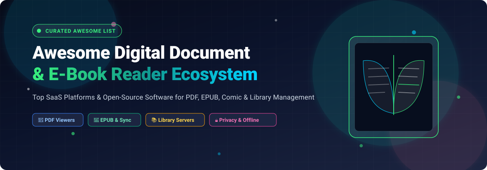

  

# 📚 Awesome Digital Document & E-Book Reader

  
  
  
  
  
  

---

## 🌟 Overview: Top Digital Document & E-Book Reader Ecosystem

> A curated, SEO-optimized directory of high-performance **SaaS platforms** and **open-source software** for **Digital Document and E-Book Readers**. Covers PDF viewers, EPUB rendering engines, comic book readers (CBZ/CBR), distraction-free e-ink interfaces, self-hosted media servers, and comprehensive library managers.

Whether you need lightweight PDF viewing for technical manuals, academic research annotation with SyncTeX/LaTeX integration, cross-device reading synchronization, or full self-hosted digital bookshelves (OPDS), this comprehensive guide tracks the most active, battle-tested solutions in the ecosystem.

---

## 📑 Table of Contents

- [📊 Sector Overview & Market Dynamics](#-sector-overview--market-dynamics)
- [☁️ SaaS & Hosted Platforms](#-saashosted-platforms)
- [💻 Open-Source GitHub Projects](#-open-source-github-projects)
  - [🏆 Top Open-Source Document & E-Book Readers (Ranked by Stars)](#-top-open-source-document--e-book-readers-ranked-by-stars)
  - [💡 Key Architectural Recommendations](#-key-architectural-recommendations)
- [🤝 How to Contribute](#-how-to-contribute)
- [💖 Support & Sponsorship](#-support--sponsorship)
- [📈 Star History](#-star-history)
- [⚠️ Disclaimer](#-disclaimer)

---

## 📊 Sector Overview & Market Dynamics

The global digital document and e-book reader ecosystem encompasses dedicated e-reader hardware (valued at approximately **$8.5B–$9.5B**, expanding at ~6% CAGR) and the digital publishing & document workflow software market valued at over **$50B**. 

The sector displays a bifurcated market structure: consumer hardware and commercial app distribution are **highly concentrated** around ecosystem giants (**Amazon Kindle, Apple Books, Rakuten Kobo, and Adobe Acrobat**) leveraging winner-take-most proprietary store lock-in. Conversely, specialized productivity tools, academic PDF viewers, self-hosted book servers, and privacy-respecting local-first readers remain **moderately to highly fragmented** across vibrant, open-source communities and independent software developers.

---

## ☁️ SaaS/Hosted Platforms

| Product | Description | Company Valuation / Revenue | Pricing (Starting) | Free Tier / Trial Limits |
|:---|:---|:---|:---|:---|
| **[Apple Books](https://www.apple.com/apple-books/)** | 🍎 Apple's native e-book & document reader across macOS, iOS, and iPadOS with iCloud position synchronization. | ~$3.5T Market Cap / ~$391B Annual Revenue (Apple Inc.) | $0.00 (included on Apple hardware; paid store catalog books individually priced) | **Free Forever**: Full reader features with unlimited personal EPUB/PDF imports; cloud sync bound to standard free 5GB iCloud storage tier |
| **[Kindle Cloud Reader](https://read.amazon.com/)** | 📦 Web browser & cloud-based Kindle reading interface enabling instant library access without app installation. | ~$2.2T Market Cap / ~$575B Annual Revenue (Amazon.com, Inc.) | $11.99/month (Kindle Unlimited starting subscription; or a-la-carte book purchases) | **Free Forever**: Web reader is free to read purchased or free catalog books; 30-day free trial for Kindle Unlimited (up to 20 titles borrowed concurrently) |
| **[Adobe Acrobat](https://www.adobe.com/acrobat/pdf-reader.html)** | 📄 Industry-standard PDF viewer and cloud document platform with annotation, form-filling, OCR, and cloud storage. | ~$215B Market Cap / ~$19.4B Annual Revenue (Adobe Inc.) | $12.99/month (Acrobat Standard, billed annually) or $19.99/month (Acrobat Pro) | **Free Forever**: Acrobat Reader desktop/mobile enables viewing, basic annotation, commenting, and form filling; web tools include 7-day free trial for Pro features |
| **[Kobo](https://www.kobo.com/)** | 📖 Global digital reading platform with cross-platform e-reader apps, cloud sync, and integrated digital bookstore. | ~$12B Market Cap / ~$14B Annual Revenue (Parent: Rakuten Group, Inc.) | $7.99/month (Kobo Plus Read eBook subscription; or per-title purchases) | **Free Forever**: Unlimited reading of sideloaded personal EPUB/PDF documents and public domain titles on free apps; 14-day free trial for Kobo Plus catalog |
| **[Foxit PDF Reader](https://www.foxit.com/pdf-reader/)** | ⚡ High-performance PDF viewing, commenting, and form-processing ecosystem built as a modular alternative to Adobe. | ~$900M Market Cap / ~$150M Annual Revenue (Foxit Software Inc., STAR: 688095) | $129.99/year (Foxit PDF Editor annual license) or $10.83/month billed annually | **Free Forever**: Foxit Reader allows viewing, basic note-taking, printing, and form-filling; full editor features available via a 14-day free trial |
| **[Kami](https://www.kamiapp.com/)** | 🎓 Cloud-based collaborative PDF annotation and interactive learning workspace designed for schools and teams. | ~$180M Valuation (NZD $300M+) / ~$22M Annual Revenue (Kami / Authentic Minds) | $149.00/year (Teacher Plan, single license) or $12.42/month | **Free Forever**: Basic Plan includes essential annotation tools (markup, highlights, text insertion) with Google Drive/OneDrive sync; premium LMS sync and audio comments locked behind 60-day teacher trial |
| **[PocketBook Cloud](https://pocketbook.ch/)** | ☁️ Digital reading and cross-device sync platform connecting mobile apps, web readers, and E Ink hardware. | ~$40M Estimated Annual Revenue (PocketBook International S.A., private) | $0.00 (free reading apps and cloud sync; books purchased individually from PocketBook shop) | **Free Forever**: Free account includes cloud sync of reading progress, notes, and up to 2GB free cloud storage for personal e-books (PDF, EPUB, MOBI) across 5 devices |

---

## 💻 Open-Source GitHub Projects

### 🏆 Top Open-Source Document & E-Book Readers (Ranked by Stars)

| Project | Stars_Badge | Description |
|:---|:---:|:---|
| **[Stirling PDF](https://github.com/Stirling-Tools/Stirling-PDF)** |  | 🛠️ **Full-suite local PDF manipulation platform.** The open-source alternative to Adobe Acrobat for PDF manipulation. Merge, split, compress, convert, OCR, sign, redact, compare, and watermark PDFs via Docker web UI or desktop app. Free for individuals and groups up to 5 users. |
| **[KOReader](https://github.com/koreader/koreader)** |  | 📱 **Versatile document viewer for E Ink devices and mobile platforms.** Tailored for Kindle, Kobo, reMarkable, PocketBook, Android, and Linux. Exceptional text reflow for PDFs, complex EPUB typesetting, dictionary lookups, Calibre sync, and Wallabag integration. |
| **[Koodo Reader](https://github.com/koodo-reader/koodo-reader)** |  | 🌐 **All-in-one modern e-book reader with cross-platform sync.** Beautiful web and desktop app supporting EPUB, PDF, MOBI, AZW3, TXT, MD, and comic archives. Built-in sync via WebDAV, Dropbox, OneDrive, Google Drive, and FTP without paid third-party services. |
| **[Calibre](https://github.com/kovidgoyal/calibre)** |  | 📚 **The undisputed standard for e-book management & format conversion.** View, edit, convert, and catalog e-books across every format imaginable. Communicates directly with physical e-readers (Kindle, Kobo, Nook), fetches metadata and covers, and includes a built-in content server. |
| **[Calibre-Web](https://github.com/janeczku/calibre-web)** |  | 🖥️ **Clean web interface for browsing and reading Calibre libraries.** Self-hosted web app that reads existing Calibre database files. Features direct in-browser EPUB/PDF reading, OPDS feed support, user management, and seamless "Send to Kindle" delivery. |
| **[SumatraPDF](https://github.com/sumatrapdfreader/sumatrapdf)** |  | ⚡ **Blazing-fast, lightweight PDF, EPUB, and comic reader for Windows.** Opens documents instantaneously with virtually zero memory overhead. Supports PDF, EPUB, MOBI, CBZ, CBR, DjVu, and XPS. Highly portable and completely free from telemetry and bloat. |
| **[Kavita](https://github.com/Kareadita/Kavita)** |  | 🚀 **Lightning-fast self-hosted digital reading server.** Designed for manga, comics, e-books, and magazines with integrated web readers, bookmarks, progress synchronization, user permissions, and native OPDS-PS support for external reader apps. |
| **[Sioyek](https://github.com/ahrm/sioyek)** |  | 🔬 **Keyboard-driven PDF reader customized for researchers and technical books.** Features smart jump-to-reference, portal viewing of figures/formulas, table-of-contents search, Synctex forward/backward search, and vim-style navigation. |
| **[Foliate](https://github.com/johnfactotum/foliate)** |  | 🍃 **Simple and modern GTK e-book reader for Linux.** Built with modern web technologies and Epub.js/Foliate-js. Features beautiful typography, paginated and scrolled viewing, annotations, text-to-speech, Wiktionary lookup, and OPDS catalog browsing. |
| **[Komga](https://github.com/gotson/komga)** |  | 🎨 **Media server for comics, mangas, BDs, and e-books.** Features rich metadata scraping (ComicInfo.xml, EPUB), web-based multi-format reader, duplicate detection, REST API, OPDS support, and deep client integrations with apps like Tachiyomi. |
| **[PDF Arranger](https://github.com/pdfarranger/pdfarranger)** |  | 📑 **Intuitive graphical tool for PDF merging, rearranging, and splitting.** Lightweight GTK application that enables effortless drag-and-drop page reordering, page rotation, cropping, and document concatenation without cloud dependencies. |
| **[Zathura](https://github.com/pwmt/zathura)** |  | ⌨️ **Minimalist, keyboard-driven document viewer with vim-like keybindings.** Highly customizable through a plugin architecture (Poppler/MuPDF, DjVu, PostScript). Provides instantaneous rendering, SyncTeX integration, and terminal-friendly efficiency. |
| **[Thorium Reader](https://github.com/edrlab/thorium-reader)** |  | ♿ **The EPUB 3 reference implementation from EDRLab.** Highly accessible desktop reading app for Windows, macOS, and Linux. Built-in support for Read Aloud (TTS), DAISY 2.02/3, audiobooks, OPDS feeds, and European LCP DRM for public library lending. |
| **[Okular](https://github.com/KDE/okular)** |  | 🛡️ **Universal document viewer from KDE with privacy-first annotation.** Universal format support (PDF, EPUB, DjVu, CBZ, Markdown). Stores highlights and annotations non-destructively, collects zero telemetry, requires no accounts, and operates cross-platform. |
| **[Theorem](https://github.com/fundaments-work/theorem)** |  | 🔐 **Local-first reading workspace with encrypted peer-to-peer sync.** Built with Tauri, Rust, and React for desktop and Android. Highlighting, annotations, TTS, reading heatmaps, RSVP speed-reader, and local LAN sync without centralized servers. |

---

### 💡 Key Architectural Recommendations

- **For Library Management & Format Conversion:** Choose **[Calibre](https://github.com/kovidgoyal/calibre)** or self-hosted **[Calibre-Web](https://github.com/janeczku/calibre-web)**.
- **For E Ink & Dedicated Readers:** Deploy **[KOReader](https://github.com/koreader/koreader)** on your Kindle, Kobo, or Android e-reader.
- **For Comics, Manga & Graphic Novels:** Host **[Kavita](https://github.com/Kareadita/Kavita)** or **[Komga](https://github.com/gotson/komga)** with OPDS streaming.
- **For Academic & Research Papers:** Use **[Sioyek](https://github.com/ahrm/sioyek)** for two-click citation jumps and figure portals.
- **For Zero-Bloat PDF Viewing on Windows:** Rely on **[SumatraPDF](https://github.com/sumatrapdfreader/sumatrapdf)** for instant load times and portable execution.
- **For Self-Hosted PDF Manipulation:** Deploy **[Stirling PDF](https://github.com/Stirling-Tools/Stirling-PDF)** via Docker.
- **For Accessibility & Public Library Lending:** Choose **[Thorium Reader](https://github.com/edrlab/thorium-reader)** with LCP DRM compliance.

---

## 🤝 How to Contribute

1. 🍴 Fork the repository.
2. 🌿 Create a feature branch: `git checkout -b feature/new-reader`.
3. 📝 Add or update an entry in `README.md` following the existing format (include product name, direct link, GitHub badge, and concise description).
4. 🚀 Submit a Pull Request detailing why the project or platform is a great addition to the ecosystem.

---

## 💖 Support & Sponsorship

Thank you for exploring this curated repository! If this resource helped you discover the perfect document viewer, e-book reader, or library server:

- ⭐ **Star the repository** to support discoverability.
- 🍴 **Fork and share** it with your fellow book lovers, researchers, and developers.
- ☕ **Support future open-source curation and maintenance**: Buy me a coffee or sponsor ongoing development via the [GitHub Sponsor Dashboard](https://github.com/sponsors/ishandutta2007).

---

## 📈 Star History

---

## ⚠️ Disclaimer

- This is an **independent, community-curated list** — inclusion does not represent an endorsement.
- Document and e-book applications frequently handle proprietary, personal, or confidential materials. Always verify data policies, telemetry settings, and cloud synchronization switches before opening sensitive documents.
- **Licensing and terms change**: Stirling PDF introduced commercial licensing for organizations with more than 5 users. Always review upstream repositories for active software licenses and platform compatibility.

---

  <b>Curated with ❤️ for readers, researchers, students, and digital archivists worldwide.</b>

